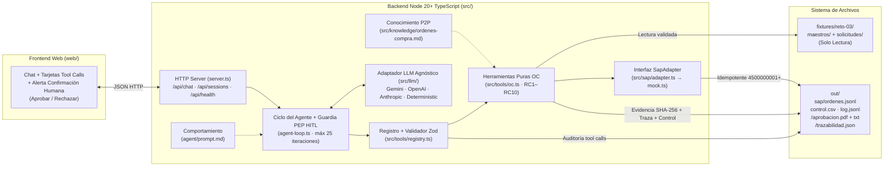

# SOLUCION.md — Agente Conversacional de Órdenes de Compra SAP (Reto 03)

> **Autor:** Santiago Pineda Botero — Ingeniero de Redes y Ciberseguridad  
> **Proceso:** Selección Equipo Perxia 2.0 · Periferia IT Group  
> **Versión:** 1.0

---

## 1. Problema en una frase y a quién le duele

Cada compra en Periferia IT Group obliga a la **analista administrativa de compras** a cruzar manualmente correos, hojas de cálculo y cotizaciones para digitar órdenes de compra en SAP y verificar de memoria topes y aprobadores, mientras **Contabilidad, Auditoría y Dirección** carecen de bloqueo sistemático de excepciones y de visibilidad sobre cuántas compras llegan con factura emitida antes de crear la OC (compras retroactivas).

---

## 2. Arquitectura de la Solución

La arquitectura separa estrictamente **comportamiento** (`agent/prompt.md`), **conocimiento normativo** (`src/knowledge/ordenes-compra.md`), **ejecución determinista** (`src/tools/oc.ts`), **orquestación y seguridad HITL** (`src/agent-loop.ts`) e **integración ERP** (`src/sap/adapter.ts`):

### Ubicación de responsabilidades
- **Comportamiento (`agent/prompt.md`)**: define el rol del agente, secuencia obligatoria de herramientas, formato de presentación y prohibiciones explícitas (no inventar valores, no cuadrar montos, no auto-confirmar excepciones).
- **Conocimiento (`src/knowledge/ordenes-compra.md`)**: documenta el proceso Procure-to-Pay y el catálogo normativo `RC1`–`RC10`.
- **Ejecución (`src/tools/oc.ts`)**: funciones puras tipadas con `zod`. Todo cálculo monetario, cruce contra maestros, inferencia de derivados y hash `SHA-256` ocurre aquí en código determinista, jamás en el modelo de lenguaje.
- **Módulo reutilizable (`modulo/`, Bonus §9.4)**: expone `modulo/agent.md`, `modulo/tools/oc.ts` (re-export directo sin copia divergente) y `modulo/skill/ordenes-compra/SKILL.md` verificados con test unitario de igualdad byte a byte.

---

## 3. Explicación del Ciclo del Agente Paso a Paso

El ciclo en [`GestorCicloAgente.procesarTurno`](src/agent-loop.ts) opera en 6 etapas deterministas:

1. **Verificación de presupuesto de sesión y estado HITL**:
   - Comprueba que `session.totalTokensUsed < SESSION_MAX_TOKENS` (120.000 por defecto) para impedir consumo ilimitado de la API key.
   - Evalúa si había una confirmación pendiente (`session.pendingConfirmation`) del turno previo:
     - Si el mensaje entrante del humano confirma explícitamente, registra el caso en `session.approvedCases` (única vía para autorizar `confirmado = true`).
     - Si el humano rechaza, limpia el estado pendiente y activa bloqueo explícito de creación en el turno.
2. **Invocación al Adaptador LLM (`LlmAdapter.enviar`)**:
   - Envía el `systemPrompt` cargado desde `agent/prompt.md`, el historial de la sesión y las declaraciones JSON Schema derivadas automáticamente de los esquemas `zod` de `src/tools/oc.ts` bajo la convención `oc_<export>`.
3. **Ejecución controlada de herramientas (bucle con tope `CA1 = 25` iteraciones)**:
   - Si el modelo solicita llamadas a herramientas (`toolCalls`), `registry.ts` valida los argumentos con `zod.safeParse` antes de ejecutar y escribe cada invocación en `out/log.jsonl` (`CA4`).
   - **Policy Enforcement Point (PEP) determinista fuera del LLM**: si el modelo intenta invocar `oc_crear` con `confirmado: true` sin que exista aprobación humana previa en `session.approvedCases` (por alucinación o *prompt injection* dentro de un adjunto), el bucle fuerza `confirmado = false` o detiene la llamada cuando el usuario pidió revisión previa (`"no la crees hasta que yo lo confirme"`).
   - Además, `oc_crear` vuelve a ejecutar internamente `evaluarPaqueteCompleto` y reconstruye el payload canónico desde disco, impidiendo cualquier alteración de montos, NIT o centros de costo.
4. **Detección de pausa por Confirmación Humana (`CA3`)**:
   - Cuando `oc_validar` reporta `apta = true` con `confirmaciones.length > 0` (`sol-004`, `sol-005`, `sol-006`) o cuando el usuario pidió vista previa antes de crear, el agente genera la evidencia (`oc_generar_evidencia`), construye el payload (`oc_construir_payload`), muestra la tabla SAP y cierra el turno con `needsConfirmation = true`.
   - El frontend resalta la tarjeta de **Solicitud de Confirmación Humana** con botones **✓ Aprobar y Crear OC en SAP** y **✕ Rechazar Solicitud**.
5. **Creación e Idempotencia**:
   - En casos limpios (`sol-001`, Objetivo `O1`) o tras el clic de confirmación del analista (`sol-004`, `sol-005`, `sol-006`), `oc_crear` invoca `SapAdapter.crearOrden`, asigna consecutivo desde `4500000001` en `out/sap/ordenes.jsonl` (retornando el existente si se repite `solicitud_id`) y agrega la fila de auditoría en `out/control.csv`.
6. **Manejo resiliente de fallos (`CA5`)**:
   - Ninguna herramienta lanza excepciones no capturadas; todas retornan `{ ok: false, error }`. Si el proveedor LLM falla por timeout o red, el error se sanitiza (redactando cualquier credencial) y se informa en el chat sin romper la sesión.

---

## 4. Elección del Modelo y Análisis de Costos

### 4.1 Proveedor y modelo elegido
- **Proveedor primario:** Google Gemini (`LLM_PROVIDER=gemini`) mediante [`GeminiAdapter`](src/llm/gemini.ts).
- **Modelo recomendado:** `gemini-2.5-flash` (`temperature: 0.1`).
- **Justificación técnica:**
  1. Excelente adherencia a *tool calling* estructurado y tablas Markdown en español con baja latencia (~1.2–2.5 s por iteración).
  2. Relación costo/beneficio óptima para flujos administrativos transaccionales donde toda la lógica numérica ya reside en herramientas deterministas.
  3. Desacoplamiento total mediante `LlmAdapter`: cambiar a `openai` (`gpt-4o-mini`), `anthropic` (`claude-3-5-haiku-latest`) o `deterministic` se hace con una sola variable de entorno sin tocar `agent-loop.ts`.

### 4.2 Estimación de tokens y costo mensual en producción

En un caso típico con herramientas (`oc_leer_paquete` → `oc_validar` → `oc_generar_evidencia` → `oc_construir_payload` → `oc_crear`, ~4 a 5 iteraciones LLM, más 1 turno adicional cuando requiere confirmación humana):

| Concepto | Tokens Entrada / Caso | Tokens Salida / Caso | Total Tokens / Caso |
|---|---:|---:|---:|
| Caso directo (`sol-001`..`sol-003`) | ~6.500 | ~900 | ~7.400 |
| Caso con confirmación HITL (`sol-004`..`sol-006`) | ~9.200 | ~1.300 | ~10.500 |
| **Promedio ponderado por solicitud** | **~8.000** | **~1.100** | **~9.100** |

*(Nota de optimización implementada: `gemini.ts` omite parámetros opcionales de caché pesada en las declaraciones de herramientas para que el modelo solo envíe `{ caso }` en lugar de re-serializar todo el objeto `paquete`, reduciendo ~65 % los tokens de salida).*

Con tarifas públicas de referencia de **Gemini 2.5 Flash** (`$0.30 USD / 1M input tokens` y `$2.50 USD / 1M output tokens`):
- **Costo promedio por solicitud procesada:**
  - Entrada: `8.000 × $0.30 / 1.000.000 = $0.00240 USD`
  - Salida: `1.100 × $2.50 / 1.000.000 = $0.00275 USD`
  - **Total por caso:** **~$0.00515 USD** (~0,5 centavos de dólar, ~22 COP por orden de compra).
- **Proyección mensual para operación corporativa:**
  - **Volumen medio (500 OC / mes):** `500 × $0.00515` = **~$2.58 USD / mes**.
  - **Volumen alto (2.000 OC / mes, incluyendo reintentos y consultas):** `2.000 × $0.00515 × 1.25` = **~$12.88 USD / mes**.

---

## 5. Matriz de Controles Implementada (`RC1` – `RC10`)

| Control | Regla Implementada | Fuente de Datos (Maestro / Soporte) | Caso de Prueba que lo Ejercita | Acción del Agente |
|---|---|---|---|---|
| **RC1** | Proveedor existe en maestro (por NIT base sin DV; si falta NIT, por razón social normalizada sin tildes/signos) y `activo = true`. | `proveedores.json` + `solicitud.json` | **`sol-002`** (NIT `901999000` no existe) · **`sol-006`** (sin NIT, resuelve por nombre) · *Unit test* (`901777888` inactivo) | **Rechazar (Bloqueo)** |
| **RC2** | Existe `aprobacion.json`, contiene palabra `"Aprobado"` (sin negación `"no aprobado"`) y `de` pertenece a `aprobadores` del `centro_costo`. | `centros-costo.json` + `aprobacion.json` | **`sol-003`** (`fvargas` es de `CC-3030`, no de `CC-2020`) | **Rechazar / Escalar (Bloqueo)** |
| **RC3** | `solicitud.valor_total <= aprobador.tope` en el `centro_costo` imputado. | `centros-costo.json` + `solicitud.json` | **`sol-001`..`sol-006`** (validación activa) · *Unit test* (`mlopez` con 60M > tope 50M en `CC-1010`) | **Rechazar / Escalar a nivel superior (Bloqueo)** |
| **RC4** | `solicitud.subarea` pertenece al arreglo `subareas` del `centro_costo`. | `centros-costo.json` + `solicitud.json` | **`sol-001`..`sol-006`** · *Unit test* (`CC-1010` con subárea `"Marketing"`) | **Rechazar (Bloqueo)** |
| **RC5** | `abs(cotizacion.total - solicitud.valor_total) / solicitud.valor_total <= 0.02` (2 %) y cotización presente. | `cotizacion.txt` + `solicitud.json` | **`sol-004`** (Solicitud `25.000.000` vs Cotización `26.500.000`, desviación **+6.00 %**) | **Escalar a Confirmación Humana** |
| **RC6** | Si falta `indicador_iva`, deriva `indicador_iva_default` del proveedor y exige confirmación; si viene código inválido, bloquea. | `proveedores.json` + `indicadores-iva.json` | **`sol-006`** (`indicador_iva` ausente → deriva `C1` IVA 19 %) | **Derivar + Confirmación Humana** |
| **RC7** | Si falta `condiciones_pago`, deriva `condiciones_pago_default` del proveedor y solo informa; si viene código inválido, bloquea. | `proveedores.json` + `condiciones-pago.json` | **`sol-006`** (`condiciones_pago` ausente → deriva `Z030` 30 días) | **Aprobar con Derivado Informativo** |
| **RC8** | Si existe `factura` con `fecha < solicitud.fecha_solicitud`, marca `retroactiva = true`, exige confirmación y audita en CSV. | `factura.txt` + `solicitud.json` | **`sol-005`** (Factura `FC-88231` del `2026-08-10` vs Solicitud `2026-08-27`, 17 días antes) | **Marcar `retroactiva=true` + Confirmación Humana** |
| **RC9** | `aprobacion.fecha (YYYY-MM-DD) >= solicitud.fecha_solicitud`. Si es anterior, pide confirmación. | `aprobacion.json` + `solicitud.json` | **`sol-001`..`sol-006`** · *Unit test* (aprobación `2026-08-20` < solicitud `2026-08-25`) | **Escalar a Confirmación Humana** |
| **RC10** | `abs((cantidad * valor_unitario) - valor_total) <= 1`. Si excede ±1 unidad monetaria, bloquea. | `solicitud.json` | **`sol-001`..`sol-006`** · *Unit test* (`10 × 100.000 ≠ 900.000`) | **Rechazar (Bloqueo)** |

### ¿Cuál regla fue la más sutil/difícil de implementar correctamente?
La combinación de **`RC1` + normalización documental (`NIT` y nombres)** junto con **`RC9` (zonas horarias ISO-8601)**:
- En los fixtures colombianos, `proveedores.json` almacena el NIT base de 9 dígitos (`"900555111"`), mientras `cotizacion.txt` y `factura.txt` usan formato tributario DIAN con puntos de miles y dígito de verificación (`"900.555.111-2"`), y `sol-006` omite el NIT por completo exigiendo resolución por razón social normalizada (con tildes y siglas societarias `S.A.S.`).
- En `RC9`, `aprobacion.fecha` viene con offset `-05:00` (`"2026-08-26T18:45:00-05:00"` en `sol-004`). Si se convirtiera ingenuamente a UTC (`23:45Z`) o en aprobaciones nocturnas (`20:30-05:00` → `01:30Z` del día siguiente), cambiaría el día calendario respecto a `fecha_solicitud` (`"2026-08-26"`). Extraer el prefijo de fecha local `YYYY-MM-DD` evita falsos positivos/negativos por huso horario.

---

## 6. Diseño Técnico del Adaptador SAP Real para Producción

Dado que la viabilidad técnica y de licenciamiento para conectarse directamente a SAP aún no está confirmada en Periferia IT Group, diseño una estrategia en dos capas: **Opción Primaria (SAP S/4HANA OData / BTP)** y **Plan B de Contingencia Cero-Fricción**.

### 6.1 Elección de protocolo de integración
1. **Si el ERP es SAP S/4HANA (Cloud o On-Premise 1909+)**: elegiría el servicio OData estándar **`API_PURCHASEORDER_PROCESS_SRV`** expuesto a través de **SAP Integration Suite / Cloud Connector** sobre HTTPS/TLS 1.3. Es RESTful, nativo en JSON, maneja *CSRF tokens* estándar y no requiere compilar binarios nativos C++ (`sapnwrfc`) dentro del contenedor Node.js.
2. **Si el ERP es SAP ECC 6.0 clásico sin SAP Gateway OData habilitado**: usaría la BAPI estándar **`BAPI_PO_CREATE1`** seguida en la misma sesión LUW por `BAPI_TRANSACTION_COMMIT`, encapsulada detrás de un microservicio interno en SAP Integration Suite (o adaptador RFC aislado en red privada).

### 6.2 Mapeo del Payload (`OrdenCompra` → `API_PURCHASEORDER_PROCESS_SRV` / `BAPI_PO_CREATE1`)

| Campo `OrdenCompra` (Agente) | OData `A_PurchaseOrder` / `A_PurchaseOrderItem` | BAPI `BAPI_PO_CREATE1` (`POHEADER` / `POITEM` / `POACCOUNT`) |
|---|---|---|
| `sociedad: "1000"` | `CompanyCode: "1000"` | `POHEADER-COMP_CODE = '1000'` |
| `organizacion_compras: "1000"` | `PurchasingOrganization: "1000"` | `POHEADER-PURCH_ORG = '1000'` |
| `proveedor.codigo_sap` | `Supplier` (relleno a 10 dígitos `LIFNR`, ej. `"0000100234"`) | `POHEADER-VENDOR = '0000100234'` |
| `moneda` | `DocumentCurrency` (`"COP"` / `"USD"`) | `POHEADER-CURRENCY` |
| `condiciones_pago` | `PaymentTerms` (`"Z030"`) | `POHEADER-PMNTTRMS` |
| `referencia.solicitud_id` | `CorrespncExternalReference` / `YY1_SolicitudID_PDH` | `POHEADER-OUR_REF` (clave de búsqueda idempotente, máx. 12 chars) |
| `referencia.cotizacion_ref` | `SupplierQuotationExternalID` | `POHEADER-QUOTATION` |
| `posiciones[].numero` | `PurchaseOrderItem: "00010"` | `POITEM-PO_ITEM = '00010'` |
| `posiciones[].descripcion` | `PurchaseOrderItemText` (≤ 40 chars `TXZ01`) | `POITEM-SHORT_TEXT` |
| `posiciones[].cantidad` / `unidad` | `OrderQuantity` / `PurchaseOrderQuantityUnit` | `POITEM-QUANTITY` / `POITEM-PO_UNIT` |
| `posiciones[].precio_unitario` | `NetPriceAmount` | `POITEM-NET_PRICE` |
| `posiciones[].indicador_iva` | `TaxCode` (`"C1"`) | `POITEM-TAX_CODE` |
| `posiciones[].centro_costo` | `to_AccountAssignment.CostCenter` (`AccountAssignmentCategory = "K"`) | `POACCOUNT-COSTCENTER` (`POITEM-ACCTASSCAT = 'K'`) |
| `aprobacion.pdf` + `evidencia_sha256` | `API_CV_ATTACHMENT_SRV` (GOS Document adjunto al `PurchaseOrder`) | `BDS_BUSINESSDOCUMENT_CREATEF` + texto cabecera `POTEXTHEADER` |

### 6.3 Autenticación y Custodia de Secretos
- **Autenticación:** OAuth 2.0 `Client Credentials` con **mTLS** contra SAP BTP Destination Service / API Management (usuario técnico de comunicación `SAP_COM_0053`, nunca cuentas humanas nominadas).
- **Dónde viven las credenciales:** en un gestor de secretos dedicado (**Azure Key Vault / AWS Secrets Manager / HashiCorp Vault**) inyectado en tiempo de ejecución únicamente al módulo `SapODataAdapter`. El LLM, el `systemPrompt`, los logs (`out/log.jsonl`) y el navegador **jamás tienen acceso ni visibilidad** sobre tokens o certificados SAP.

### 6.4 Idempotencia, Reintentos y Errores Parciales
1. **Idempotencia de extremo a extremo:**
   - Antes de hacer `POST /A_PurchaseOrder`, `buscarOrdenPorReferencia(solicitud_id)` ejecuta `GET /A_PurchaseOrder?$filter=CorrespncExternalReference eq '<solicitud_id>'`.
   - Adicionalmente se envía cabecera `Idempotency-Key: sha256(sociedad + solicitud_id)` en el API Gateway y bloqueo distribuido (Redis/PostgreSQL `SELECT FOR UPDATE`) por `solicitud_id` para evitar condición de carrera si dos pestañas confirman al mismo segundo.
2. **Atomicidad ante error parcial:**
   - La creación de cabecera + posiciones + imputación `K` viaja en un único `$batch` OData *changeset* transaccional: si falla una posición o el centro de costo está bloqueado en `KS03`, SAP hace *rollback* completo y devuelve los mensajes `BAPIRET2` / `error.innererror.errordetails`.
   - Si la OC se crea (`450000xxxx`) pero falla la subida posterior del adjunto PDF (`API_CV_ATTACHMENT_SRV`), **NO se re-ejecuta `crearOrden`** (evitando duplicados): la orden queda en estado `CREADA_PENDIENTE_ADJUNTO` en cola de reintentos exponenciales solo para el servicio de adjuntos.

### 6.5 Plan B si la conexión directa a SAP no es viable a corto plazo
Como la integración depende de permisos TI/licenciamiento SAP, el agente entrega valor inmediato desde el día 1 sin tocar `agent-loop.ts` ni `oc.ts` implementando un `LsmwBatchSapAdapter` que cumpla la misma interfaz `SapAdapter`:
- Genera una **plantilla TSV/CSV de carga masiva compatible con SAP LSMW / LTMC (`ME21N` Batch Input)** junto con una vista "Copiar en 1 clic para SAP GUI" y el archivo `aprobacion.pdf` ya firmado con `SHA-256`.
- Así se mantiene el **100 % de los controles preventivos (`RC1`–`RC10`) y el 100 % de la medición de compras retroactivas (`out/control.csv`)**, reduciendo en ~80 % el tiempo operativo de la analista mientras TI habilita el endpoint OData.

---

## 7. Análisis Crítico del Desvío en Órdenes Retroactivas (`sol-005`)

### 7.1 Diagnóstico de Control Interno, Segregación de Funciones (SoD) y Auditoría
En `sol-005`, la factura electrónica `FC-88231` fue emitida el **`2026-08-10`**, pero la solicitud de compra recién se radicó el **`2026-08-27`** (17 días después) y la líder aprobó el **`2026-08-28`** escribiendo: *"Ya llegó la factura, por favor crear la OC para poder radicarla"*. Este patrón (*maverick buying* / hecho cumplido) genera cuatro riesgos severos:

1. **Anulación del control preventivo presupuestal:** el gasto ya es exigible legalmente ante la DIAN/proveedor cuando llega al aprobador; la aprobación deja de ser una decisión de gasto y se degrada a un trámite formal para destrabar tesorería.
2. **Ruptura de Segregación de Funciones (SoD):** quien solicita negocia y compromete directamente a la compañía con el proveedor saltándose a Compras y la comparación competitiva de cotizaciones.
3. **Riesgo financiero y tributario (FEV / RADIAN en Colombia):** recibir facturas electrónicas sin OC previa dificulta el acuse de recibo oportuno, expone a aceptación tácita de facturas con precios/impuestos no negociados y distorsiona el corte de provisiones contables mensuales.
4. **Riesgo de auditoría y fraude:** en auditoría ISO 27001 / SOX / Revisoría Fiscal, una OC emitida con fecha posterior a la factura evidencia debilidad material en el ciclo *Procure-to-Pay* (*Three-Way Match* simulado a posteriori).

### 7.2 Cómo lo detecta el agente
La herramienta pura `evaluarRetroactivaRC8` cruza determinísticamente `factura.fecha` contra `solicitud.fecha_solicitud`. Cuando `factura.fecha < solicitud.fecha_solicitud`, marca `retroactiva = true`, calcula los días exactos de desfase (`17 días` en `sol-005`), bloquea la creación silenciosa exigiendo confirmación humana (`RC8`) y persiste la bandera `retroactiva = true` en `out/control.csv`.

### 7.3 Propuesta de Gobierno para la Dirección
No recomiendo bloquear de golpe el 100 % el primer día (paralizaría pagos a proveedores con facturas ya emitidas), sino un **Plan de Gobierno gradual en 90 días**:
1. **Mes 1 (Visibilidad ejecutiva):** publicar tablero semanal desde `out/control.csv` con `% de OC retroactivas por Centro de Costo, Solicitante y Proveedor`. Lo que se mide con nombre propio cae drásticamente.
2. **Mes 2 (Escalamiento de autoridad):** toda compra con `retroactiva = true` pierde el flujo de aprobación regular del gerente de área y exige firma de **Dirección Financiera / Gerencia General** + justificación escrita de urgencia.
3. **Mes 3 (Política "No PO, No Pay" + Órdenes Abiertas):** comunicar formalmente a proveedores recurrentes (ej. papelería, nube, licencias) que el portal de recepción de facturas rechazará automáticamente cualquier XML/PDF de factura electrónica que no referencie un número `450000xxxx` emitido con fecha anterior, habilitando *Blanket Purchase Orders* (contratos marco) para consumos trimestrales repetitivos como el de `sol-005`.

---

## 8. Decisiones de Diseño y Trade-offs

| # | Decisión Tomada | Alternativa Descartada | Por qué se eligió esta opción |
|---|---|---|---|
| **1** | **Guardia HITL determinista en el backend (`agent-loop.ts` + re-validación en `oc_crear`)** | Confiar únicamente en instrucciones dentro de `agent/prompt.md` para pedir confirmación. | En ciberseguridad, un prompt es una guía probabilística, no una frontera de control. Forzar `confirmado = false` en código hasta recibir un turno humano posterior impide que una alucinación o un *prompt injection* en `cotizacion.txt` cree una OC sin permiso. |
| **2** | **Servidor único `node:http` nativo + Frontend Vanilla ES Modules sin bundler pesado** | Dos servidores separados (Express + Vite/Next.js SPA con build complejo). | Arranca en `< 500 ms` con un solo comando, elimina errores CORS en despliegue Docker gratuito, reduce superficie de ataque por dependencias transitivas y mantiene una UI rápida y clara. |
| **3** | **Lector `.xlsx` propio sobre `node:zlib` en lugar de `xlsx` (SheetJS npm)** | Mantener `xlsx@0.18.5` del registro público de npm. | `npm audit` reporta vulnerabilidades conocidas de *Prototype Pollution* y *ReDoS* en `xlsx@0.18.5`. Reemplazarlo por `src/utils/xlsx-reader.ts` eliminó esa dependencia vulnerable cumpliendo la herramienta P1 `oc_leer_excel` con código auditable. |
| **4** | **Declaraciones de herramientas compactas hacia el LLM (`{ caso }`) manteniendo el contrato completo en TypeScript** | Obligar al LLM a re-enviar en cada llamada el JSON completo de `paquete` y `derivados`. | Evita que el LLM trunque o altere campos intermedios al copiar JSON entre herramientas y ahorra ~65 % de tokens de salida por caso, mientras `demo.ts` y los tests siguen pudiendo pasar `{ caso, paquete, derivados }` según el contrato §6.2. |

---

## 9. Supuestos y Observaciones PRD vs. Fixtures

1. **Truncamiento controlado a 40 caracteres (`EKPO-TXZ01`)**: el PRD §7.4 exige `posiciones[].descripcion` de máximo 40 caracteres, mientras las descripciones en `solicitud.json` tienen hasta 73 caracteres (`sol-001`). Se trunca determinísticamente a 40 caracteres en el payload SAP y se conserva la descripción íntegra en `out/<caso>/trazabilidad.json`.
2. **Normalización de NITs**: `proveedores.json` registra NITs de 9 dígitos sin dígito de verificación (`900555111`), mientras `cotizacion.txt` y `factura.txt` incluyen puntos y `-DV` (`900.555.111-2`). Se normaliza extrayendo la raíz numérica antes del guion.
3. **Campos adicionales informativos en fixtures**: `centros-costo.json` incluye `nombre` del centro y de cada aprobador, y `correo.json` / `aprobacion.json` incluyen `para` y `cc`. Los esquemas `zod` los aceptan y aprovechan para enriquecer la evidencia PDF y los mensajes de diagnóstico sin romper el esquema base del PRD.
4. **Inferencia de unidad de medida (`UN` | `H` | `MES`)**: como `solicitud.json` no trae columna `unidad`, se deriva determinísticamente (`"H"` cuando la descripción especifica bolsa de horas como en `sol-004`, `"MES"` para mensualidades y `"UN"` por defecto) dejando rastro en `trazabilidad.json`.

---

## 10. Cobertura de Historias de Usuario y Pendientes para Producción

| Historia / Entregable | Estado | Detalle Implementado | Qué faltaría para Producción Real |
|---|---|---|---|
| **HU-1 · Leer paquete (`oc_leer_paquete`)** | **Hecho (100 %)** | Normaliza correo, solicitud, cotización, aprobación y factura; reporta faltantes sin lanzar excepción. | Conector automático a buzón Microsoft Graph / Exchange (`compras@periferia...`) y OCR para PDFs escaneados. |
| **HU-2 · Validar controles (`oc_validar`)** | **Hecho (100 %)** | Implementa `RC1`–`RC10` + herramientas atómicas individuales. | Consulta en tiempo real a tablas maestras SAP (`LFA1`, `CSKS`) con caché TTL corto. |
| **HU-3 · Construir payload (`oc_construir_payload`)** | **Hecho (100 %)** | Valida con `OrdenCompraSchema` (`zod`) y escribe `out/<caso>/trazabilidad.json`. | Soporte multi-posición (`10, 20, 30...`) cuando un Excel traiga múltiples líneas de ítem. |
| **HU-4 · Evidencia (`oc_generar_evidencia`)** | **Hecho (P0 + P1)** | Genera tanto `aprobacion.txt` (P0) como `aprobacion.pdf` (`pdf-lib`, P1) con hash `SHA-256`. | Verificación criptográfica de cabeceras DKIM/SPF del `.eml` original para evitar suplantación de remitente. |
| **HU-5 · Crear OC (`oc_crear`)** | **Hecho (100 %)** | Secuencia `4500000001+`, idempotencia por `solicitud_id`, `ordenes.jsonl` y `out/control.csv`. | Adaptador OData real + base de datos transaccional PostgreSQL con bloqueo concurrente. |
| **HU-6 · Manejo de errores y P1 Excel** | **Hecho (100 %)** | Respuestas `{ ok: false, error }` tipadas, sanitización de secretos y `oc_leer_excel` (P1). | Cola de reintentos (Dead-Letter Queue) y alertas en Microsoft Teams / SIEM. |
| **Bonus §9.4 (`modulo/`)** | **Hecho (100 %)** | `modulo/agent.md`, `modulo/tools/oc.ts` y `modulo/skill/ordenes-compra/SKILL.md` sin divergencia. | Publicación en registro privado npm (`@periferia/perxia-oc-sap`). |

---

## 11. Declaración de Uso de Asistentes de IA

- **Asistentes utilizados:**
  1. **Google Antigravity (Gemini):** empleado como par de programación para aceleración de scaffolding en TypeScript estricto, implementación de herramientas con `zod`, pruebas unitarias en `Vitest`, maquetación CSS de la interfaz de chat y estructuración arquitectónica.
  2. **Claude Code (Anthropic):** empleado para auditoría independiente de calidad contra la rúbrica del PRD, generación del informe consolidado de evidencias (`docs/EVIDENCIAS_PRUEBAS_RETO03.pdf` con salidas de tests, ejecución determinista y capturas de interfaz) y revisión de empaquetado final.
- **Decisiones revisadas y descartadas respecto a sugerencias iniciales:**
  1. **Descarte de `xlsx` (SheetJS):** inicialmente se instaló `xlsx@0.18.5` para cubrir la herramienta P1 `oc_leer_excel`; al auditar con `npm audit`, detecté vulnerabilidades sin parche en npm y lo reemplacé por un lector propio sobre `node:zlib` (`src/utils/xlsx-reader.ts`).
  2. **Descarte de validación delegada al LLM:** rechacé cualquier enfoque donde el LLM comparara fechas o calculara el 2 % de desviación en el prompt; toda regla `RC1`–`RC10` quedó codificada en funciones puras deterministas y verificadas sin LLM en `demo.ts`.
  3. **Endurecimiento de `oc_crear`:** agregué reconstrucción canónica del payload dentro de `oc_crear` para que ni siquiera un *prompt injection* pueda modificar `precio_unitario` o `confirmado`.

---

## 12. Riesgos de Producción, Seguridad y Mitigaciones

1. **Suplantación de correo de aprobación (Spoofing / BEC):** en archivos planos `de: "mlopez@..."` es texto; en producción el conector de correo debe validar firmas **SPF + DKIM + DMARC** del `.eml` original o migrar la aprobación a un flujo autenticado con Entra ID (SSO).
2. **Inyección indirecta de prompts (*Indirect Prompt Injection*) en cotizaciones o correos de terceros:** mitigado separando el *Policy Enforcement Point* en TypeScript (`agent-loop.ts` + `oc_crear`), sin `child_process`/shell, con rutas confinadas contra *Path Traversal* y esquemas `zod` estrictos.
3. **Exposición de secretos y PII en logs:** la API key se lee exclusivamente de `process.env` en el servidor, nunca viaja al frontend ni aparece en `/api/health`, y `sanitizarErrorSinSecretos` redacta patrones `key=...`, `AIza...` o `sk-...` antes de registrar errores.
4. **Indisponibilidad o agotamiento de cuota del proveedor LLM:** mitigado con timeout configurable (`LLM_TIMEOUT_MS=30000`), presupuesto de tokens por sesión (`SESSION_MAX_TOKENS`), multi-proveedor (`gemini`/`openai`/`anthropic`) y el modo de contingencia sin LLM (`DeterministicFallbackAdapter`, activable con `LLM_PROVIDER=deterministic` o `LLM_FALLBACK_DETERMINISTIC=true`).
5. **Efimeridad de disco en contenedores gratuitos (Render/Fly):** en PaaS gratuitos el directorio `out/` se reinicia al redesplegar; en producción `out/control.csv` y `out/sap/` deben persistirse en almacenamiento inmutable (S3/Azure Blob con *Object Lock* WORM para auditoría) y PostgreSQL.
